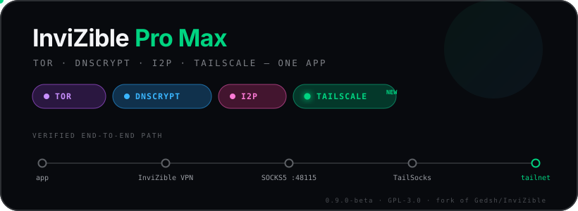
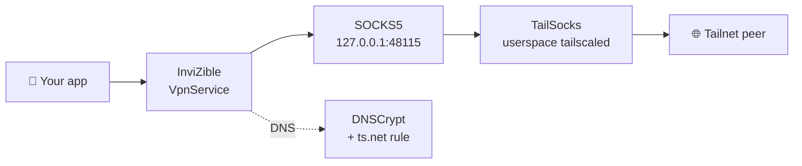

<div align="center">



<br>

[](https://github.com/Moose1005/InviZible/tags)
[](#-status--read-before-you-trust-it)
[](https://www.gnu.org/licenses/gpl-3.0.txt)
[](https://github.com/Gedsh/InviZible)

**A community fork of [InviZible Pro](https://github.com/Gedsh/InviZible) that folds Tailscale into the stack — so your tailnet rides the same tunnel as everything else.**

</div>

---

## What this fork adds

Upstream InviZible Pro runs **Tor**, **DNSCrypt** and **Purple I2P** as togglable modules. This fork adds a fourth:

> ### 🔗 Tailscale — as a first-class module
> Reach your tailnet **without giving up InviZible's tunnel**. Android only allows one VPN at a time, so instead of hot-swapping apps, this bridges to [**TailSocks**](https://github.com/bropines/tailsocks) — a userspace `tailscaled` — over a signature-protected IPC channel. No root required.

**One toggle does everything.** Flipping Tailscale on will:

| | |
|---|---|
| 🔌 | Point InviZible's SOCKS5 proxy at TailSocks (`127.0.0.1:48115`) |
| 🌐 | Add the `ts.net` DNS forwarding rule so MagicDNS resolves |
| 🛡️ | Exclude TailSocks from the VPN tunnel so its WireGuard can reach the mesh |
| 🔒 | Force DNSCrypt on and **lock it** — see [why](#why-dnscrypt-locks) |
| ⚖️ | Disable Tor and I2P (mutually exclusive by design) |

Flipping it off reverts **all** of it. No orphaned config.

---

## How it works



This exact path is **verified end-to-end on-device**, with evidence captured at both ends — not assumed from the fact that it compiles.

<details>
<summary><b>Why DNSCrypt locks</b> — it's a leak fix, not a UI quirk</summary>

<br>

DNSCrypt owns the capturing `VpnService` that routes proxied traffic into the SOCKS5 hop. An adversarial audit found that Tailscale could report **Running** while that service was down — with DNSCrypt, Tor, I2P and the firewall all off, app traffic would egress **clearnet** while the UI claimed protection.

A privacy tool must fail *closed*. So DNSCrypt is now force-enabled and locked whenever Tailscale is on, and the VPN lifecycle accounts for Tailscale's state. That leak state is now unreachable.

</details>

<details>
<summary><b>Security audit</b> — 21 findings, all 5 critical/high fixed and verified</summary>

<br>

An adversarial multi-agent review of the bridge produced 21 confirmed findings. All five that materially threatened leak-safety are fixed and **runtime-verified on-device**:

| # | Severity | Issue | Status |
|---|---|---|---|
| 1 | 🔴 Critical | Tailscale could run with no capturing VPN → clearnet egress | ✅ Fixed |
| 2 | 🟠 High | TailSocks never removed from VPN bypass on disable | ✅ Fixed |
| 3 | 🟠 High | TailSocks' TUN mode could seize the VpnService slot | ✅ Fixed |
| 5 | 🟠 High | Stopping Tor/I2P mid-start *re-launched* them | ✅ Fixed |
| 6 | 🟠 High | Module lock didn't survive rotation/backgrounding | ✅ Fixed |

15 lower-severity findings (config hygiene, IPC hardening, self-healing state races) remain open — none are believed to be leaks.

</details>

---

## ⚠️ Status — read before you trust it

**This is beta.** It works, and the core path is proven — but it is not yet something to route sensitive traffic through unexamined.

- **Requires Android's _"Block connections without VPN"_ to be OFF.** That's a device-wide kill switch, and disabling it is a real security tradeoff. Not yet resolved.
- **15 lower-severity audit findings** still open.
- **IPv6 to the tailnet is untested.** No soak or long-run stability testing yet.
- **Debug-signed builds only.** No release-signing story yet.
- **SOCKS5 is TCP-only by design** — UDP (QUIC/HTTP3) is refused rather than proxied. It fails closed, but some apps need QUIC disabled to work.

---

## Roadmap

- [x] Tailscale as a fourth module, bridged to TailSocks
- [x] One-toggle auto-config, fully reversible
- [x] Close all critical/high audit findings, verified on-device
- [x] Prove the end-to-end traffic path with evidence at both ends
- [x] First public tagged release
- [ ] Close the remaining 15 audit findings
- [ ] Resolve the kill-switch tradeoff (keep lockdown *on*)
- [ ] Disable IPv6 to the tailnet, or prove it leak-safe
- [ ] Soak, reboot, doze and network-switch stability testing
- [ ] Release signing + reproducible builds
- [ ] Material 3 UI rework ([design tokens already landed](docs/UI_INTEGRATION_CONTRACT.md))
- [ ] Long term: fold the Go core in-process, removing the second app entirely

---

## Building

Requires JDK 17, Android SDK, and NDK `23.1.7779620`.

```bash
./gradlew :tordnscrypt:assembleFdroidArm64Debug     # real device
./gradlew :tordnscrypt:assembleFdroidX86_64Debug    # emulator
```

You also need [**TailSocks**](https://github.com/bropines/tailsocks) installed. **Both apps must be signed with the same key** — the bridge is gated behind a signature-level permission, and a mismatch fails silently.

It is expected that you can solve build problems yourself, so there is no support for building. Prebuilt versions of upstream **InviZible Pro** are available [here](https://github.com/Gedsh/InviZible/releases/latest).

---

## Credits & attribution

This is an **unofficial community fork**. All credit for InviZible Pro belongs to its author.

| | |
|---|---|
| **InviZible Pro** | [Garmatin Oleksandr](https://github.com/Gedsh) — [Gedsh/InviZible](https://github.com/Gedsh/InviZible) |
| **TailSocks** | [bropines](https://github.com/bropines) — userspace `tailscaled` for Android |
| **This fork** | Tailscale integration, security fixes, UI rework |

InviZible Pro uses:

* [DNSCrypt](https://github.com/jedisct1/dnscrypt-proxy)
* [Tor](https://www.torproject.org/)
* [Purple I2P](https://github.com/PurpleI2P/i2pd)
* [Chainfire/libsuperuser](https://github.com/Chainfire/libsuperuser)
* [jaredrummler/AndroidShell](https://github.com/jaredrummler/AndroidShell)
* [NetGuard](https://github.com/M66B/NetGuard)
* [Angads25/android-filepicker](https://github.com/Angads25/android-filepicker)
* [meefik/busybox](https://github.com/meefik/busybox)

This product is produced independently from the **Tor®**, **DNSCrypt**, **Purple I2P** and **Tailscale** software and carries no guarantee from the above projects about quality, suitability or anything else.

### Translating

[Translate InviZible on Hosted Weblate](https://hosted.weblate.org/engage/invizible/).

### Support the original author

The upstream project is maintained by Garmatin Oleksandr. If this software is useful to you, support **upstream** — these are his addresses, not this fork's:

<details>
<summary>Donation addresses</summary>

<br>

**Patreon**: https://www.patreon.com/inviziblepro

**BTC**: 1GfJwiHG6xKCQCpHeW6fELzFfgsvcSxVUR

**LTC**: MUSAXkcAvnN1Ytauzeo9bwjVjarUdDHGgk

**BCH**: qzl4w4ahh7na2z23056qawwdyuclkgty5gc4q8tw88

**USDT**: 0xdA1Dd53FE6501140E3Dcd5134323dfccF20aD536

**XLM**: GBID6I3VYR4NIFLZWI3MEQH3M2H72COC3HQDI5WMYYQGAC3TE55TSKAX

**XMR** 82WFzofvGUdY52w9zCfrZWaHVqEDcJH7y1FujzvXdGPeU9UpuFNeCvtCKhtpC6pZmMYuCNgFjcw5mHAgEJQ4RTwV9XRhobX

</details>

---

## License

[**GNU General Public License version 3**](https://www.gnu.org/licenses/gpl-3.0.txt)

Copyright (c) 2019-2026 Garmatin Oleksandr invizible.soft@gmail.com

All rights reserved

This file is part of **InviZible Pro**.

**InviZible Pro** is free software: you can redistribute it and/or modify it under the terms of the GNU General Public License as published by the Free Software Foundation, either version 3 of the License, or (at your discretion) any later version.

**InviZible Pro** is distributed in the hope that it will be useful, but WITHOUT ANY WARRANTY; without even the implied warranty of MERCHANTABILITY or FITNESS FOR A PARTICULAR PURPOSE. See the GNU General Public License for more details.

You should have received a copy of the GNU General Public License along with **InviZible Pro**. If not, see [http://www.gnu.org/licenses/](https://www.gnu.org/licenses/)
